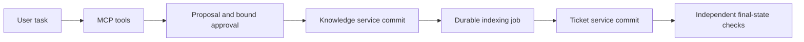

# CaseFlow architecture

A real stdio MCP server exposes raw or task-level business tools plus two separately
counted host helpers. A model chooses calls. W0/W1 receive identical full SOP
bytes; W2 receives names/descriptions and must actually load the same files.
There is no hidden host router selecting a gold Skill for a task.

The gateway's SQLite ledger fixes actor/scope, full proposal digest, approval
identity/decision/expiry and operation identity. The knowledge and ticket systems
are separate actual HTTP/PostgreSQL services. Knowledge reuses Notebook ORM,
versioning and Markdown chunking. Each service commits its own idempotency receipt
with its business state. A durable pending index job must become current/searchable
before ticket closure. A newer concurrent version supersedes an old index job.
Approval is checked before each new side-effect dispatch. An expired/revoked
approval after partial commit leaves that authorized knowledge version recorded
and prevents further ticket writes; no distributed rollback is promised.

The user and approval simulator provide only predeclared facts/decisions. They do
not supply reference tool sequences or correct outputs. Task scoring reads real
services/ledgers; a model's completion sentence is insufficient. Blocked task
success additionally requires the corresponding observed interaction and a typed
blocked disposition. State preservation is a separate invariant. Structured-status
validation is not arbitrary natural-language truth assessment. Synthetic tasks,
approval waits and local endpoints do not prove real-user acceptance or time saved.

## Standalone packaging

The package namespace and project CLI are new. Domain execution/verification logic is retained from the measured source commit. Dependencies and assets are self-contained; no sibling checkout or original workstation path is required. See PROVENANCE.json for per-file identity.
